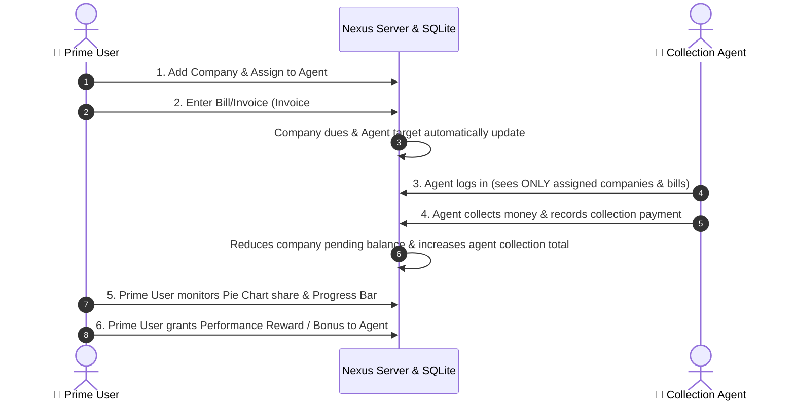

# 👑 Nexus Corporate Collection & Recovery Management System
> **Multi-Role Portal:** Separate Login for Prime User & Collection Agents  
> **Architecture:** Zero-dependency Node.js HTTP Server + Native SQLite (`node:sqlite`) + Modern Single Page Interface

---

## 🚀 Overview

The **Nexus Corporate Collection System** provides dedicated workspaces for both the **Prime User** (Master Administrator) and **Collection Agents**:

1. **👑 Prime User Login**:
   - Master authority over the entire agency.
   - Issues and registers **Company Bills & Invoices** with **Invoice Number**, **Invoice Date**, **Invoice Amount**, and **Payment Due Date**.
   - Assigns and reassigns companies to collection agents.
   - When a bill is added for a company, the company's total dues and the assigned agent's recovery target **automatically increase**.
   - Tracks the **Overall Progress Bar**, the **Interactive Agent Collection Share Pie Chart**, and the **Leaderboard**.
   - Awards performance bonuses and commissions to agents based on collection milestones.

2. **👤 Collection Agent Login**:
   - Each agent logs into their own personal workspace.
   - Agents **only see the companies assigned to them**.
   - Agents see the specific invoices/bills issued by the Prime User for their accounts.
   - When an agent collects money from a company, the **agent logs the collection directly in their portal**.
   - Real-time personal progress bar, target achievement %, collected tally, and rewards earned.
   - Collections recorded by agents automatically update company balances, overall agency progress, and the Prime User's pie chart in real-time!

---

## 🔑 Login Credentials

The application provides a login screen with tabbed role selection and 1-click demo buttons:

### 1. 👑 Prime User (Master Admin)
- **Role Tab**: Prime User Login
- **Username / Email**: `prime` or `admin@nexus.com`
- **Password**: `admin123`
- *(Or click "1-Click Prime User Access" for instant login)*

### 2. 👤 Collection Agents
Select any agent from the dropdown and use password `agent123` (or click their quick chip):
- **Alex Mercer**: `alex.mercer@collections.com` (Assigned: Apex Logistics, Nexus Tech)
- **Brenda Vance**: `brenda.vance@collections.com` (Assigned: Global Retail, Horizon Media)
- **Carlos Mendez**: `carlos.m@collections.com` (Assigned: Quantum Manufacturing, Vertex Financial)
- **Diana Prince**: `diana.p@collections.com` (Assigned: Stellar Pharma, BlueWave Maritime)
- **Evan Wright**: `evan.w@collections.com` (Assigned: Titan Construction, Aurora Clean Energy)

---

## 📋 End-to-End Workflow

---

## 🌐 How to Access the Live Application

The server is currently running live in the background:

- **[http://localhost:3050](http://localhost:3050)**
- **[http://127.0.0.1:3050](http://127.0.0.1:3050)**

*(To restart manually in the future, run `node server.js` or `npm start` in `d:\BRT Application\Sample`).*
