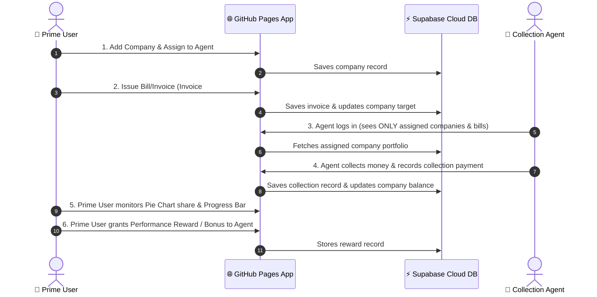

# 👑 Nexus Corporate Collection & Recovery Management System
> **Multi-Role Portal:** Separate Login for Prime User & Collection Agents  
> **Deployment:** Runs directly in browser on GitHub Pages or locally with Node.js  
> **Database:** Supabase PostgreSQL Cloud or Local SQLite

---

## 🌐 Live GitHub Pages Application
Open the live application directly in your browser:
**[https://ravitejabrt.github.io/nexus-collections/](https://ravitejabrt.github.io/nexus-collections/)**

---

## ⚡ Direct Supabase Connection (How Data is Stored)

The web application connects directly to your **Supabase Cloud Database** via the official Supabase Client SDK without needing an external Node.js hosting platform:

1. **Create the Supabase Tables & Triggers**:
   - Open your [Supabase Dashboard](https://supabase.com/dashboard) &rarr; Go to **SQL Editor** &rarr; **New Query**.
   - Copy and paste the entire contents of [`supabase_schema.sql`](supabase_schema.sql) and click **Run**.
   - This creates the `agents`, `companies`, `invoices`, `collections`, `rewards` tables, triggers, and seed data.

2. **Connect the App using Project URL & API Key**:
   - Open [https://ravitejabrt.github.io/nexus-collections/](https://ravitejabrt.github.io/nexus-collections/) in your browser.
   - The **"Connect Supabase Database"** dialog will pop up (or click the **⚡ Supabase** badge at the top).
   - Enter your:
     - **Supabase Project URL** (e.g. `https://your-project.supabase.co`)
     - **Supabase API Key** (the `anon` `public` key from Supabase Dashboard &rarr; Project Settings &rarr; API)
   - Click **Save & Connect Database**.
   - The application connects immediately to Supabase and saves the credentials securely in your browser's `localStorage`!

---

## 📁 Files to Upload to GitHub Repository Root

To ensure GitHub Pages launches the web application directly (instead of README), make sure the following files are located in the **root directory** (`/`) of your GitHub repository:

| File Name | Purpose |
| :--- | :--- |
| `index.html` | Application main HTML page (must be in root for GitHub Pages) |
| `styles.css` | Complete stylesheet for styling, modal dialogs, and responsive UI |
| `app.js` | Direct Supabase CRUD engine, role authentication, charts, and table logic |
| `.nojekyll` | Tells GitHub Pages to serve static web assets directly without Jekyll |
| `supabase_schema.sql` | SQL script to create tables and triggers in Supabase |
| `README.md` | Project documentation and user guide |

---

## 🔑 Login Credentials

### 1. 👑 Prime User (Master Admin)
- **Role Tab**: Prime User Login
- **Username / Email**: `prime` or `admin@nexus.com`
- **Password**: `admin123`
- *(Or click "1-Click Prime User Access" for instant login)*

### 2. 👤 Collection Agents
Select any agent from the dropdown and use password `agent123` (or click their quick chip):
- **Alex Mercer**: `alex.mercer@collections.com` (Assigned: Apex Logistics, Nexus Tech)
- **Brenda Vance**: `brenda.vance@collections.com` (Assigned: Global Retail, Horizon Media)
- **Carlos Mendez**: `carlos.m@collections.com` (Assigned: Quantum Manufacturing, Vertex Financial)
- **Diana Prince**: `diana.p@collections.com` (Assigned: Stellar Pharma, BlueWave Maritime)
- **Evan Wright**: `evan.w@collections.com` (Assigned: Titan Construction, Aurora Clean Energy)

---

## 📋 End-to-End Workflow

